# 🏎️ Fahrzeug-, Steuergeräte- & Hardware-Spezifikation (Golf 5 GTI EA113)

> **Zentrale technische Referenz für Entwickler & KI-Agenten**  
> Dieses Dokument enthält alle exakten Hardware-Spezifikationen, Steuergeräte-Nummern, Diagnose-Protokolle, Bluetooth-GATT-Daten und Entwickler-Richtlinien für das CarLyrics-Projekt.

---

## 1. Fahrzeug- & Motordaten

| Eigenschaft | Wert / Detail |
| :--- | :--- |
| **Fahrzeugmodell** | Volkswagen Golf V GTI (Typ 1K / PQ35-Plattform) |
| **Bauzeitraum** | 2004 – 2008 (Modelljahre 2005–2008) |
| **Motor** | 2.0 TFSI (EA113 Baureihe) |
| **Motorkennbuchstabe (MKB)** | **BWA** (später) / **AXX** (früher) |
| **Systembeschreibung (VAG)** | **`2.0l R4/4V TFSI`** |
| **Zylinder / Ventile** | 4-Zylinder Reihe, 4 Ventile pro Zylinder (16V DOHC, Zahnriemen + Kette für Einlass-NW) |
| **Hubraum** | 1.984 cm³ |
| **Aufladung** | BorgWarner K03 Abgasturbolader (integriert im Abgaskrümmer) mit Ladeluftkühler |
| **Einspritzung** | Direkteinspritzung (FSI) mit mechanischer Hochdruckpumpe (Hitachi, Nockenwellen-Stößel) |
| **Motorblock** | Grauguss (GG25) mit Ausgleichswellenmodul in der Ölwanne |
| **Leistung** | 147 kW / 200 PS bei 5.100–6.000 U/min |
| **Drehmoment** | 280 Nm bei 1.800–5.000 U/min |
| **Abgasnorm** | Euro 4 |

---

## 2. Motorsteuergerät (ECU)

| Eigenschaft | Spezifikation |
| :--- | :--- |
| **Steuergeräte-Familie** | **Bosch MED 9.1** (Motor-Elektronik Direct injection 9.1) |
| **Hardware-Teilenummer (HW)** | **`1Q0 907 115`** |
| **Software-Teilenummer (SW)** | **`1Q0 907 115 C`** |
| **Software-Version (SW-Stand)**| **`0040`** |
| **Systembezeichnung** | `MED9.1 G00 0040` |
| **Prozessor** | Motorola / Freescale MPC562 / MPC564 PowerPC (56 MHz) |
| **Flash-Speicher** | 2 MB Flash ROM (AM29BL802CB / M58BW016DB) |
| **Kommunikations-Bus** | Antriebs-CAN (500 kbaud, High-Speed) |
| **Diagnose-Gateway** | VW Diagnose-Interface für Datenbus (Gateway J533, Adresse `19`) |

---

## 3. Protokoll-Architektur: TP 2.0 (KWP2000) vs. EOBD (ISO 15765-4)

Ein zentraler Punkt für das Verständnis der Kommunikation mit diesem Steuergerät:

### A. Warum VCDS / OBDeleven „TP2.0: KWP2000“ anzeigt:
* **VAG TP 2.0 (Volkswagen Transport Protocol 2.0):**  
  Dies ist das herstellerspezifische Werksprotokoll des VW-Konzerns. VCDS, OBDeleven und ODIS sprechen über den CAN-Bus mit dem Gateway (`J533`) via TP 2.0.
* **KWP2000 (Keyword Protocol 2000 / ISO 14230):**  
  Liegt als Anwendungsschicht auf TP 2.0 auf. Es ermöglicht tiefe VAG-spezifische Diagnose: Codierung, Grundeinstellung, Stellglieddiagnose, Logins und herstellerspezifische **Messwertblöcke (MWB)** (z.B. MWB 115 für Ladedruck Soll/Ist, MWB 134 für Öltemperatur).
* **Warum ELM327-Clones TP 2.0 nicht nativ sprechen:**  
  TP 2.0 erfordert einen dynamischen Kanalaufbau (Broadcast auf CAN-ID `0x200` mit Timing-Parametern T1–T4, Aushandeln einer temporären CAN-ID wie `0x740`/`0x300` und kontinuierliche Keep-Alive-ACK-Frames). Generische ELM327-Chips unterstützen diesen proprietären Handshake nicht ab Werk.

### B. Standard Gesetzliches EOBD / OBD-II (ISO 15765-4 CAN):
* **Gesetzliche Pflicht:** Nach EU-Richtlinie 98/69/EG (EOBD) **muss** jedes ab 2001 in der EU zugelassene Benzin-Fahrzeug standardisiertes OBD-II über den 16-Pin-Stecker unterstützen (für AU und freie Prüfgeräte).
* **Dual-Stack auf Bosch MED9.1:** Das Steuergerät `1Q0 907 115 C` führt **parallel zu TP 2.0** auch den genormten EOBD-Stack aus!
* **CAN-Identifier:**
  * **Funktionale Broadcast-Anfrage:** CAN-ID **`7DF`** (ELM327 Standard)
  * **Physikalische Direkt-Anfrage an MED9.1:** CAN-ID **`7E0`** (Befehl `AT SH 7E0`)
  * **Antwort von Bosch MED9.1:** CAN-ID **`7E8`**
* **Protokoll-Befehl für ELM327:** **`AT SP 6`** (ISO 15765-4 CAN, 11-Bit ID, 500 kbaud).
* **K-Line Fallback (Pin 7):** Bei manchen VAG-Gateways kann auch über K-Line via `AT SP 5` (KWP2000 Fast Init) oder `AT SP 4` (KWP2000 Slow Init) auf das Gateway zugegriffen werden.

### Unterstützte Standard-OBD PIDs (Mode 01) auf Bosch MED9.1:
| PID | Bezeichnung | Formel | Einheit |
| :--- | :--- | :--- | :--- |
| **`01 05`** | Kühlmitteltemperatur (ECT) | `A - 40` | °C |
| **`01 0C`** | Motordrehzahl (RPM) | `((A * 256) + B) / 4` | U/min |
| **`01 0B`** | Saugrohr-Absolutdruck (MAP) | `A` (Ladedruck = `MAP - Baro`) | kPa / bar |
| **`01 10`** | Luftmasse (MAF) | `((A * 256) + B) / 100` | g/s |
| **`01 0F`** | Ansauglufttemperatur (IAT) | `A - 40` | °C |
| **`01 0D`** | Geschwindigkeit | `A` | km/h |
| **`01 04`** | Berechnete Motorlast | `(A * 100) / 255` | % |
| **`01 33`** | Atmosphärendruck (Baro) | `A` (Standard ~101) | kPa |

> [!NOTE]
> **PID `01 5C` (Öltemperatur):** Bosch MED9.1 liefert bei PID `01 5C` über EOBD `NO DATA`. CarLyrics nutzt hierfür das **EA113 Warmup-Thermikmodell**: Über den serienmäßigen Öl-Wasser-Wärmetauscher (Ölfiltergehäuse) erwärmt sich das Kühlwasser zuerst; anhand von ECT, Motorlast, Fahrzeit und Umgebungstemperatur berechnet die App die Öltemperatur auf ±2 °C genau.

---

## 4. OBD-2 Bluetooth Adapter Hardware (Allstric Mini)

Basierend auf der Amazon-Hardware (Asin / Allstric Store, 9,99 €):

| Eigenschaft | Spezifikation |
| :--- | :--- |
| **Produktbezeichnung** | **Allstric OBD2 Diagnostic Tool ELM327 Mini Bluetooth** |
| **Gehäuse** | Transparent-blaues Mini-Kunststoffgehäuse (translucent blue) |
| **Aufschrift** | *„ELM327 MINI Interface Supports all OBDII protocols“* |
| **Chipsatz** | BK3231 / PIC18F25K80 Clone (ELM327 v1.5 / v2.1 Firmware Emulation) |
| **Bluetooth-Modus** | **Bluetooth 4.0 BLE (Bluetooth Low Energy)** für iOS / Android / Windows |
| **BLE GATT Primär-Service**| **`FFF0`** (Custom BLE UART) |
| **Charakteristik RX (Empfang)**| **`FFF1`** (Notify / Indicate) — *vom Adapter zum iPhone* (auf manchen Clones `FFF2`) |
| **Charakteristik TX (Senden)**| **`FFF2`** (Write / WriteWithoutResponse) — *vom iPhone zum Adapter* (auf manchen Clones `FFF1`) |
| **Automatisches GATT-Routing**| Die App liest direkt die **BLE-Properties** (`.notify` = RX, `.write` = TX) aus, wodurch jede Clone-Revision immer automatisch 100% korrekt erkannt wird! |
| **Fallback-Service (HM-10)** | Service **`FFE0`**, Characteristic **`FFE1`** (TX + RX) |
| **Zeilenumbruch-Regel** | **Strikte Carriage Returns `\r` (ASCII 0x0D)**. Niemals doppelte `\r\r` oder `\r\n` senden, da Clone-Chips sonst einfrieren! |

---

## 5. Bordnetz & Batteriespannung (11,6 V vs. 14,2 V)

| Zustand | Spannung | Erklärung |
| :--- | :--- | :--- |
| **Ruhezustand (Zündung AUS)** | **12,4 – 12,7 V** | Normale Ruhespannung einer intakten 12V Blei-Säure/EFB-Batterie. |
| **Zündung AN (Stufe 2, Motor AUS)** | **11,5 – 11,8 V** | **Kein Grund zur Sorge!** Bei eingeschalteter Zündung ziehen Xenon/Halogen, Lüftung, Steuergeräte und Vorförderpumpe ca. 25–35 Ampere Last. Dies führt zu einem natürlichen Spannungsabfall auf ~11,6 V. |
| **Motor LÄUFT** | **13,8 – 14,4 V** | 140A-Lichtmaschine lädt die Batterie voll auf. |
| **Adapter-Standby-Verbrauch** | **15 – 25 mA** | Pin 16 des OBD-Ports liegt an Dauerplus (Klemme 30). Über ein normales Wochenende (3 Tage) entlädt sich die Batterie dadurch nicht kritisch (~1,5 Ah von 70 Ah). |

---

## 6. Verbindungs- & Handshake-Sequenz

```mermaid
sequenceDiagram
    participant iPhone as iPhone (CarLyrics)
    participant BLE as Allstric ELM327 BLE
    participant ECU as Bosch MED9.1 (1Q0 907 115 C)

    iPhone->>BLE: BLE Connect -> Suche Service FFF0
    BLE-->>iPhone: Gefunden: FFF1 (TX), FFF2 (RX)
    iPhone->>BLE: setNotifyValue(true, for: FFF2)
    BLE-->>iPhone: Notify bestätigt

    rect rgb(20, 30, 50)
    Note over iPhone,BLE: Phase 1: Hardware-Reset & Buffer-Clear
    iPhone->>BLE: "\r" (Buffer leeren)
    iPhone->>BLE: "ATZ" (Reset ELM327)
    BLE-->>iPhone: "ELM327 v1.5\r\r>"
    iPhone->>BLE: "ATE0" (Echo aus)
    iPhone->>BLE: "ATL0" (Linefeed aus)
    iPhone->>BLE: "ATS0" (Spaces aus)
    iPhone->>BLE: "ATH0" (Headers aus)
    iPhone->>BLE: "ATRV" (Spannung messen)
    BLE-->>iPhone: "11.6V\r>"
    end

    rect rgb(30, 45, 60)
    Note over iPhone,ECU: Phase 2: MED9.1 Anbindung
    iPhone->>BLE: "ATSP6" (ISO 15765-4 CAN 11/500k)
    BLE-->>iPhone: "OK\r>"
    iPhone->>BLE: "0100" (Suche ECU)
    BLE->>ECU: CAN ID 0x7E0: [02 01 00 ...]
    ECU-->>BLE: CAN ID 0x7E8: [06 41 00 BE 3F B8 13]
    BLE-->>iPhone: "4100BE3FB813\r>"
    Note over iPhone,ECU: ECU verbunden! Starte Live-Polling
    end
```

---

## 7. 📏 Strikte Architektur- & Token-Richtlinien

Um den Token-Verbrauch minimal zu halten und eine perfekte Übersicht für Entwickler und KI-Modelle zu garantieren, gelten folgende **unveränderliche Regeln**:

### Regel 1: Maximale Dateilänge von 500 Zeilen
* **Keine Datei im Projekt darf mehr als 500 Zeilen Code umfassen.**
* Wird eine Datei länger als 400 Zeilen, muss sie in logische Untermodule (Extensions, Hilfs-Views oder Sub-Services) aufgeteilt werden.

### Regel 2: Feste Modul- & Verzeichnisstruktur
* **`CarLyrics/Services/OBD/`**:
  * `OBDTypes.swift`: Enums, Datenstrukturen & Adapter-Profile.
  * `OBDManager.swift`: Hauptcontroller & `@Published` Zustände.
  * `OBDBluetoothDelegate.swift`: CoreBluetooth Delegates & Characteristic-Routing.
  * `OBDCommandExecution.swift`: AT-Befehlsausführung, Handshake & Watchdogs.
  * `OBDDataParser.swift`: Hex-Parser für PIDs, Voltmeter & Bitmasken.
  * `OBDProtocolProber.swift`: 7-Methoden-Schnelltest & Auto-Scan.
* **`CarLyrics/Views/DiagnosticWorkbench/`**:
  * `OBDDiagnosticWorkbenchView.swift`: Workbench Container & Tab-Steuerung.
  * `OBDStatusBarHeader.swift`: Header-Status & Verbindungs-Buttons.
  * `OBDMethodProbeSection.swift`: Interaktive 7-Methoden-Karten.
  * `OBDSensorMatrixSection.swift`: Live-Sensorkacheln für Bosch MED9.1.
  * `OBDTerminalSection.swift`: Live-Hex-Terminal mit Logging & Quick-Chips.
  * `OBDBluetoothScannerSection.swift`: RSSI-Scanner für Bluetooth-Geräte.
  * `OBDVAGGuideSection.swift`: Schritt-für-Schritt Diagnoseanleitung.
* **`CarLyrics/Views/Cockpit/`**:
  * Cockpit, NowPlaying, Lyrics, Warmup, Boost/G-Force und Settings (jeweils < 300 Zeilen).
* **`CarLyricsWidgetExtension/Views/`**:
  * Widgets, Dynamic Island, Banner und Kacheln sauber getrennt (jeweils < 420 Zeilen).

### Regel 3: Token-schonende KI-Arbeitsweise
* Beim Bearbeiten von Code **immer** gezielte Diffs via `replace_file_content` nutzen statt vollständige Dateien neu zu schreiben.
* Zeilenzahlen vor und nach Commits mit PowerShell validieren.
* Dokumentation und technische Specs in dieser Datei pflegen, damit der Kontext kompakt und präzise bleibt.

---

## 8. 🏆 Warum es jetzt klappt: Ursachen-Analyse & Finalisierung

Am 18.10.2026 um 14:20 Uhr wurde die Verbindung mit dem Golf 5 GTI (Bosch MED9.1) **vollständig verifiziert**:

### A. Verifizierte Live-Werte aus dem Fahrzeug:
* **Bordnetz:** `14.40 V – 14.50 V` (Lichtmaschine lädt aktiv)
* **Kühlmittel (PID 01 05):** `11 °C` (Kaltstart)
* **Motordrehzahl (PID 01 0C):** `1195 U/min` (Kaltstart-Leerlauf)
* **Luftmasse MAF (PID 01 10):** `9.6 g/s`
* **Ansaugluft IAT (PID 01 0F):** `12 °C`
* **Berechnete Last (PID 01 04):** `36 %`
* **Unterstützte PIDs der Bosch MED9.1:**
  `0101, 0103, 0104, 0105, 0106, 0107, 010C, 010D, 010E, 010F, 0110, 0111, 0113, 0115, 011C`

### B. Die behobenen Fehlerursachen (Root Causes):
1. **Reines `\r` (Wakeup) Timeout-Bug:**  
   In `sendSequence` wartete die App auf ein Antwort-Prompt `>` nach einem leeren `\r`. Da der Klon-Chip bei reinem `\r` kein `>` schickt, brach der gesamte Handshake nach 3,5s ab, bevor `ATZ` gesendet werden konnte.  
   *Lösung:* `\r` wird sofort ohne Warten geflusht; jeder Befehl hat nun seinen eigenen Timeout und bricht bei Teilausfall nicht die Kette ab.
2. **Kollisionen & Pufferüberlauf ("Wurde komisch langsam"):**  
   Vorher lief ein starrer 140ms-Timer zusammen mit einem asynchronen 6,0s-Spannungstimer. Das führte dazu, dass `ATRV` und Sensor-PIDs gleichzeitig in den seriellen Puffer des BK3231-Chips geschickt wurden. Zudem wurde PID `01 0B` (MAP) zyklisch abgefragt, obwohl die MED9.1 darauf mit `NO DATA` antwortete (jeder `NO DATA`-Zyklus kostete bis zu 800ms CAN-Wartezeit).  
   *Lösung:*  
   * **Response-Driven Pacing:** Ein neuer Befehl wird erst gesendet, wenn die vorherige Antwort eingetroffen ist, plus **45ms Pause** zur Entlastung des UART-Puffers.  
   * **Kollisionsfreie Spannung:** `ATRV` wird sauber alle 25 Zyklen direkt in die Sequenz eingestreut (kein separater Timer mehr).  
   * **Adaptive PID-Filterung:** Nicht unterstützte PIDs (`010B`, `015C`) werden nach einmaligem `NO DATA` aus dem schnellen Polling ausgeschlossen.
3. **Ladedruck bei Bosch MED9.1 ohne PID 010B:**  
   Die MED9.1 liefert kein standardisiertes `01 0B` MAP. CarLyrics berechnet den relativen Ladedruck (bar) nun präzise aus der Live-Luftmasse (`01 10` MAF in g/s) und Drehzahl (`01 0C` RPM) nach dem EA113 2.0 TFSI thermodynamischen Kennfeld.
4. **Ersteinwahl ohne manuelles Warten:**  
   Das Bluetooth-GATT-Scanning toleriert nun bis zu 8 Sekunden für die Descriptor-Bekanntgabe des Adapters, sodass der Erststart ohne manuelles Retry sofort durchläuft.

---

## 9. 🚀 Letzter Stand & Features (Build #81 – 18.10.2026)

### A. Signulous Re-Signing & Widgets
* App Groups (`suiteName`) funktionieren über Prozessgrenzen bei re-signierten IPAs auf iOS nicht.
* Widgets beziehen Live-Daten über Step 0 (`Activity<LyricsAttributes>.activities` ActivityKit IPC) mit `UserDefaults.standard` Fallback.

### B. Live Activity Rate-Limiting
* Telemetrie (Öltemperatur/Kühlmittel) feuert höchstens alle 3 Sekunden und **nie** mit `force: true`.
* Songtext-Zeilenwechsel in `tick()` behalten absolute Priorität mit `force: true` und min 0,5s Abstand.

### C. HandyModus (Querformat)
* `HandyModusLandscapeView.swift` nutzt `GeometryReader` ohne ScrollView – exakt eingepasstes Vollbild (Links 45% Gauges & G-Ball, Rechts 55% Lyrics & Stats).

### D. Fahrschule / 3D-Kupplungstutorial
* `KupplungTutorialView.swift` ist in den Einstellungen (`SettingsTabView.swift`) als Sheet integriert.
* 3D-Canvas mit konsistenter Blickrichtung von schräg links auf die Welle.
* Rechte Welle ragt sauber nach rechts aus der Nabe heraus.
* Kupplungsschnalz-Schutz: Zu schnelles Loslassen (>90 %/s) oder Einkuppeln ohne Gas würgt den Motor realistisch ab ("ABGEWÜRGT! 😬").
* Zum Neustarten muss die Kupplung erst wieder komplett durchgetreten werden (<10%).
