# 🏎️ Fahrzeug- & Hardware-Spezifikation (Golf 5 GTI EA113)

Dieses Dokument dient als zentrale technische Referenz für das gesamte Entwicklerteam und alle KI-Agenten. Hier sind alle Hardwaredaten, Steuergeräte-Spezifikationen, Diagnose-Protokolle, Bluetooth-Charakteristiken und Besonderheiten des Fahrzeugs exakt dokumentiert.

---

## 1. Fahrzeugdaten

| Eigenschaft | Wert |
| :--- | :--- |
| **Fahrzeugmodell** | Volkswagen Golf V GTI (Typ 1K) |
| **Bauzeitraum** | 2004 – 2008 (Modelljahre 2005–2008) |
| **Motor** | 2.0 TFSI (EA113 Baureihe) |
| **Motorkennbuchstabe (MKB)** | **BWA** (später) / **AXX** (früher) |
| **Zylinder / Ventile** | 4-Zylinder Reihe, 4 Ventile pro Zylinder (16V) |
| **Hubraum** | 1.984 cm³ |
| **Einspritzung & Aufladung** | Benzindirekteinspritzung (FSI) mit BorgWarner K03 Abgasturbolader & Ladeluftkühler |
| **Motorblock** | Grauguss (GG25) mit Ausgleichswellenmodul |
| **Leistung** | 147 kW / 200 PS bei 5.100–6.000 U/min |
| **Drehmoment** | 280 Nm bei 1.800–5.000 U/min |
| **Abgasnorm** | Euro 4 |

---

## 2. Motorsteuergerät (ECU)

| Eigenschaft | Wert |
| :--- | :--- |
| **Hersteller / Typ** | **Bosch MED9.1** (Motor-Elektronik Direct injection 9.1) |
| **Prozessor** | Motorola / Freescale MPC562 / MPC564 PowerPC (56 MHz) |
| **Speicher** | 2 MB Flash ROM (AM29BL802CB / M58BW016DB) |
| **Kommunikations-Bus** | Antriebs-CAN (500 kbaud, High-Speed) |
| **Diagnose-Gateway** | VW Gateway (J533, Adresse `19`), leitet OBD-Diagnoseanfragen an den Antriebs-CAN weiter |
| **Direkte ECU-Adresse** | **`7E0`** (Anfrage an Motor-ECU) / **`7E8`** (Antwort von Motor-ECU) |

---

## 3. OBD-II & CAN-Bus Spezifikation

| Eigenschaft | Wert |
| :--- | :--- |
| **OBD-Norm** | ISO 15765-4 CAN (11-Bit ID, 500 kbaud) |
| **ELM327 Protokoll-Befehl** | **`AT SP 6`** (festes Erzwingen von ISO 15765-4 11/500) |
| **Alternativer Direkt-Header** | **`AT SH 7E0`** (spricht die Bosch MED9.1 direkt an) |
| **OBD-Stecker-Position** | Fahrerseite links unten im Fußraum (oberhalb der Pedale, violett/schwarzer 16-Pin Stecker) |
| **Pinbelegung OBD-Port** | • **Pin 16:** Dauerplus (+12V Batterie, Klemme 30 – **immer unter Strom!**) • **Pin 4:** Karosserie-Masse (GND) • **Pin 5:** Signal-Masse (GND) • **Pin 6:** CAN-High (Antriebs-CAN) • **Pin 14:** CAN-Low (Antriebs-CAN) • **Pin 7:** K-Leitung (ISO 9141 / KWP2000, für ältere VAG-Module) |

### Unterstützte Standard-OBD PIDs (Mode 01) auf Bosch MED9.1:
* **`0105`**: Kühlmitteltemperatur (ECT) in °C — Formel: `A - 40`
* **`010C`**: Motordrehzahl (RPM) — Formel: `((A * 256) + B) / 4`
* **`010B`**: Saugrohr-Absolutdruck (MAP) in kPa — Ladedruck = `MAP - Baro`
* **`0110`**: Luftmasse (MAF) in g/s — Formel: `((A * 256) + B) / 100`
* **`010F`**: Ansauglufttemperatur (IAT) in °C — Formel: `A - 40`
* **`010D`**: Fahrzeuggeschwindigkeit in km/h — Formel: `A`
* **`0104`**: Berechnete Motorlast in % — Formel: `(A * 100) / 255`
* **`0133`**: Atmosphärendruck (Baro) in kPa — Standard ~101 kPa auf Meereshöhe

> [!IMPORTANT]
> **Warum PID `015C` (Öltemperatur) auf Bosch MED9.1 nicht im Standard-OBD antwortet:**  
> Bei Fahrzeugen der VAG-Plattform Golf 5 (PQ35) mit Bosch MED9.1 ist die Öltemperatur im Standard-OBD2-Protokoll **nicht** freigeschaltet (liefert `NO DATA`). Sie ist werksseitig nur über den proprietären VAG-Messwertblock (KWP2000 / UDS Block 029) erreichbar.  
> **Lösung der App:** CarLyrics nutzt hierfür das hochentwickelte **EA113 Warmup-Thermikmodell**, das anhand des integrierten Öl-Wasser-Wärmetauschers, Kühlmitteltemperatur, Motorlast und Außentemperatur die Öltemperatur auf ±2 °C genau nachbildet!

---

## 4. OBD-2 Bluetooth Adapter Hardware (Allstric Mini)

| Eigenschaft | Spezifikation |
| :--- | :--- |
| **Produktname** | **Allstric OBD2 Diagnostic Tool ELM327 Mini Bluetooth** |
| **Gehäuse** | Transparent-blaues Mini-Kunststoffgehäuse |
| **Aufdruck** | *"ELM327 MINI Interface Supports all OBDII protocols"* |
| **Bluetooth-Version** | **Bluetooth 4.0 / BLE (Bluetooth Low Energy)** |
| **Kompatibilität** | iOS (iPhone/iPad via BLE), Android, Windows |
| **BLE GATT Services** | • **`FFF0`** (Primärer UART-Dienst) • **`FFF1` (TX):** Write/WriteWithoutResponse (iPhone sendet Befehle) • **`FFF2` (RX):** Notify/Indicate (Adapter sendet Antworten an iPhone) • Fallback HM-10: Service **`FFE0`**, Characteristic **`FFE1`** (TX + RX) |
| **Ruhestrom** | ca. 25–40 mA bei Zündung AUS (da Pin 16 an Dauerplus Klemme 30 hängt) |

---

## 5. Bordelektronik, Batterie & Zündungs-Verhalten

| Zustand | Typische Spannung | Erklärung |
| :--- | :--- | :--- |
| **Ruhespannung (Zündung AUS)** | **12,4 – 12,7 V** | Batterie voll geladen, Steuergeräte schlafen nach ca. 15 Minuten ein. |
| **Zündung AN (Stufe 2, Motor AUS)** | **11,5 – 11,8 V** | **Völlig normaler Lastabfall!** Abblendlicht (~10A), Lüftergebläse (~10A), Intank-Benzinpumpe (~8A) und Steuergeräte ziehen sofort ~25–35 Ampere. Durch den Innenwiderstand sackt selbst eine gesunde Batterie auf 11,6 V ab. |
| **Motor LÄUFT (Standgas / Fahrt)** | **13,8 – 14,4 V** | Die 140A Lichtmaschine liefert volle Ladespannung und versorgt alle Systeme. |

---

## 6. ELM327 Handshake- & Initialisierungs-Architektur

Um den Allstric ELM327 Adapter unter allen Umständen zuverlässig mit der Bosch MED9.1 zu verbinden, verwendet die App folgende optimierte Befehlssequenz:

```mermaid
sequenceDiagram
    participant iPhone as iPhone (CarLyrics)
    participant BLE as Allstric ELM327 BLE
    participant ECU as Bosch MED9.1 (CAN 500k)

    iPhone->>BLE: Connect & Discover Characteristics (FFF1=TX, FFF2=RX)
    BLE-->>iPhone: Char Discovery complete
    iPhone->>BLE: SetNotifyValue(true) auf FFF2
    BLE-->>iPhone: didUpdateNotificationState (Notify bestätigt)
    
    rect rgb(20, 30, 50)
    Note over iPhone,BLE: 1. Hardware Wakeup & Reset
    iPhone->>BLE: "\r" (Puffer leeren)
    iPhone->>BLE: "ATZ" (Chip Reset -> bootet ELM327 v1.5)
    BLE-->>iPhone: "ELM327 v1.5\r\r>"
    end

    rect rgb(30, 45, 60)
    Note over iPhone,BLE: 2. Durchsatz & Filter optimieren
    iPhone->>BLE: "ATE0" (Echo aus)
    iPhone->>BLE: "ATL0" (Linefeeds aus)
    iPhone->>BLE: "ATS0" (Spaces aus -> schnellerer Durchsatz)
    iPhone->>BLE: "ATH0" (Headers aus)
    iPhone->>BLE: "ATRV" (Bordspannung messen -> Zündungs-Check)
    BLE-->>iPhone: "14.2V\r>"
    iPhone->>BLE: "ATI"  (Firmware Version verifizieren)
    end

    rect rgb(40, 20, 60)
    Note over iPhone,ECU: 3. Golf 5 VAG-CAN Bus binden
    iPhone->>BLE: "ATSP6" (ISO 15765-4 CAN 11/500k fest einstellen)
    BLE-->>iPhone: "OK\r>"
    iPhone->>BLE: "0100" (Lese unterstützte PIDs)
    BLE->>ECU: CAN ID 0x7E0: [02 01 00 00 00 00 00 00]
    ECU-->>BLE: CAN ID 0x7E8: [06 41 00 BE 3F B8 13]
    BLE-->>iPhone: "4100BE3FB813\r>"
    Note over iPhone,ECU: ECU erkannt! Start Live Sensor Polling
    end
```

---

## 7. Dateistruktur-Architektur (< 500 Zeilen pro Datei)

Um maximale Lesbarkeit, Übersicht und optimierte Token-Nutzung bei KI-Refactorings zu gewährleisten, ist die Codebasis streng modular gegliedert:

* **`CarLyrics/Services/OBD/`**:
  * `OBDTypes.swift`: Alle Datenmodelle, Enums, Protokolle und Konstanten (< 150 Zeilen).
  * `OBDManager.swift`: Haupt-Controller, Published Properties, Polling-Timer (< 350 Zeilen).
  * `OBDBluetoothDelegate.swift`: CoreBluetooth Delegates, GATT Characteristic Mapping (`FFF1`/`FFF2`) (< 250 Zeilen).
  * `OBDCommandExecution.swift`: Low-Level SendCommand, Handshake-Sequenz, Watchdog (< 250 Zeilen).
  * `OBDDataParser.swift`: Parsing der Hex-Antworten (PIDs, Voltmeter, Bitmaske) (< 250 Zeilen).
  * `OBDProtocolProber.swift`: Automatischer 7-Methoden Schnelltest (< 180 Zeilen).
* **`CarLyrics/Views/DiagnosticWorkbench/`**:
  * `OBDDiagnosticWorkbenchView.swift`: Container & Segment-Navigation (< 150 Zeilen).
  * `OBDStatusBarHeader.swift`: Verbindungsstatus, Voltmeter-Pill & Toggle (< 120 Zeilen).
  * `OBDMethodProbeSection.swift`: Protokoll-Schnelltest & manuelle Aktivierung (< 200 Zeilen).
  * `OBDSensorMatrixSection.swift`: Live Sensor-Kacheln & MED9.1 PID-Matrix (< 220 Zeilen).
  * `OBDTerminalSection.swift`: Live Hex-Terminal, Quick-Chips, Log-Kopieren, ACK-Mode (< 250 Zeilen).
  * `OBDBluetoothScannerSection.swift`: BLE Device Scanner & Signalstärke (< 150 Zeilen).
  * `OBDVAGGuideSection.swift`: Golf 5 GTI Praxishandbuch (< 160 Zeilen).
* **`CarLyrics/Views/`**:
  * Modulare SwiftUI Views für Dashboard, 3-Kachel-System, Telemetrie, Lyrics & Settings (alle < 400 Zeilen).
* **`CarLyricsWidgetExtension/`**:
  * Modulare Widgets für Dynamic Island, Lock Screen Live Activity und CarPlay Dashboard (alle < 400 Zeilen).
